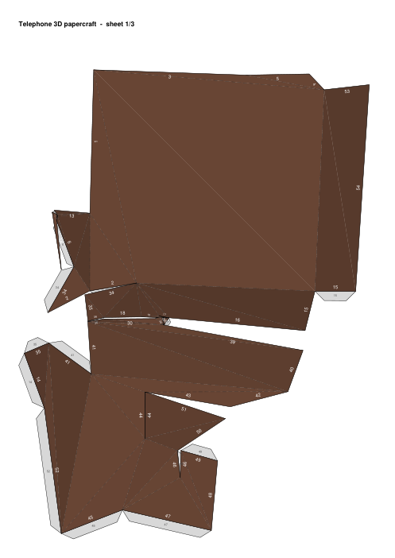

# photo2paper

Turn a photo of **any object** into a printable cut, fold, and glue papercraft model.

```
photo  ──►  AI image-to-3D model  ──►  simplify  ──►  unfold  ──►  A4 PDF
           (TRELLIS / Hunyuan3D-2,      (~150 flat     (non-overlapping pieces,
            free on Hugging Face)        faces)         numbered glue tabs)
```

Nothing is preset per object. A photo of a headphone, a pen, or a telephone goes through the same pipeline.

| Input photo | Output sheet (1 of 3) |
|---|---|
|  |  |

Full output: [examples/telephone_papercraft.pdf](examples/telephone_papercraft.pdf)

## Run it on GitHub (no install)

**Option A: upload a photo**
1. Open the [`photos/`](photos) folder on GitHub, then choose **Add file → Upload files**.
2. Drop in your photo, for example `headphones.jpg`, and click **Commit changes**.
3. After a few minutes, `papercraft/headphones.pdf` appears. You can follow the progress in the **Actions** tab.

**Option B: from a link.** Open **Actions → Make papercraft → Run workflow**, then paste an image URL and a name.

The PDF is also attached to each run under **Artifacts**, together with the 3D model.

> This repo is public, so photos you upload here are public too.

**Free AI quota.** Anonymous use of the hosted models allows only a few photos a day. To raise the limit, create a free token at [huggingface.co/settings/tokens](https://huggingface.co/settings/tokens) with the "Read" role. Then add it under **Settings → Secrets and variables → Actions → New repository secret** with the name `HF_TOKEN`.

## Run it on your computer

### Install

```
pip install -r requirements.txt
```

### Use

```
python photo2paper.py headphones.jpg                 # photo -> PDF
python photo2paper.py pen.png --faces 100 --size 180 # fewer, bigger faces; 18 cm long
python photo2paper.py model.glb --photo pen.png      # skip the AI step, unfold your own 3D model
```

| Option | Meaning |
|---|---|
| `--faces` | Number of flat faces (default 150). Fewer faces make the model easier to build; more faces keep more detail. |
| `--size`  | Length of the finished model's longest side in mm (default 150) |
| `--out`   | Output PDF path |
| `--photo` | With a 3D-model input: source photo for the cover page and the fallback colour |

The PDF has an instruction page, then A4 sheets. Solid lines are cuts. Dashed lines are valley folds. Dash-dot lines are mountain folds. Each cut edge has a number, and you glue its grey tab under the edge with the same number.

## How it works

1. **Photo → 3D**: calls the free hosted [TRELLIS](https://huggingface.co/spaces/trellis-community/TRELLIS) model, with [Hunyuan3D-2](https://huggingface.co/spaces/tencent/Hunyuan3D-2) as a fallback. The model guesses the hidden back and sides.
2. **Simplify**: welds texture seams, drops floating fragments, then decimates in stages to the target face count. It also removes folded-over faces and retries nearby targets until the mesh is closed.
3. **Unfold** (`unfold.py`): grows flat pieces across the gentlest folds first. A face is rejected if it would overlap its piece or make the piece too large for A4.
4. **Annotate and lay out**: marks mountain or valley folds and numbers each cut edge pair. Glue tabs go on the side where they don't collide. The pieces are rotated and packed onto pages, then drawn with reportlab.

## Limits

- **Free GPU quota.** Anonymous use of the hosted models allows only a few generations per day. A free Hugging Face token raises that limit: `set HF_TOKEN=hf_...` (PowerShell: `$env:HF_TOKEN="hf_..."`).
- **Colour.** The tool uses the model's texture when there is one. If the texture is missing (Hunyuan returns shape only) or blank, the whole model gets the photo's main colour.
- **One photo.** The back of the object is the AI's guess.
- **Thin parts.** Thin parts such as cables, handles, and pen clips get simplified away or turn into small, fiddly pieces.
- **Assembly.** Unfolding, tab pairing, and overlap checks are tested automatically, but a model has not been physically built yet.

## Tests

```
python -m pytest tests
```

The tests check that every glued edge has exactly two matching sides of equal length, every pair has exactly one tab, no piece overlaps itself, and the paper area matches the 3D surface area.

Example photo: `typical_misc_telephone.png` from the [TRELLIS](https://github.com/microsoft/TRELLIS) examples (MIT).
